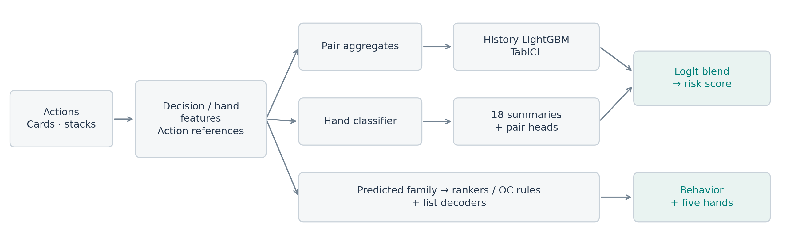

# Poker pair detection — 5th place solution

Training and inference code for Team Leo's entry in
[Detect Suspicious Value Transfers in Poker](https://www.kaggle.com/competitions/detect-suspicious-value-transfers-in-poker).
The final S5/J50 submission scored **0.93012 Public / 0.93416 Private** and placed fifth.

Pair detection combines LightGBM history models, TabICL and pooled hand scores.
Separate models classify behavior and rank evidence hands.
[The writeup](WRITEUP.md) describes the features, model combination and validation.



## Setup

Use Linux x86-64 with Python 3.12. The neural and TabICL stages require CUDA;
the original runs used two NVIDIA T4 GPUs. Allow at least 40 GB of working disk
space. CPU and GPU stages use separate environments to preserve their numerical
behavior.

```bash
uv sync --locked --python 3.12
uv venv --python 3.12 .gpu-venv
uv pip install --python .gpu-venv/bin/python -r package/requirements-gpu.txt \
  --extra-index-url https://download.pytorch.org/whl/cu128
```

Install the model archive supplied with this release:

```bash
python download_models.py --archive /path/to/poker_s5_j50_models_v2.zip
uv run --locked python verify_release.py
uv run --locked pytest -q
```

`download_models.py` checks every file against `MODELS.json`. The archive contains
fitted weights, feature-index arrays and the public TabICL checkpoint. The code
archive contains the ordered feature schemas and configuration.

## Data

Download the original competition files through Kaggle and put these eight files
in one directory outside the repository:

```text
players.parquet       hands.parquet
seats.parquet         actions.parquet
development_labels.csv
development_evidence.csv
evaluation_pairs.csv
sample_submission.csv
```

Competition data and generated features are not included in this repository.

## Inference

```bash
uv run --locked python run_solution.py --data /path/to/data \
  --cpu-python "$PWD/.venv/bin/python" \
  --gpu-python "$PWD/.gpu-venv/bin/python" --jobs 3
```

Add `--plan` to print the stages without running them. Completed stages are
recorded, so the same command resumes an interrupted run. Start from a fresh
extraction when changing code or weights.

The final prediction is `s5/result/S5_J50_risk.csv`, with SHA-256:

```text
cb25c90604e5c5bc8be323c9b3a83fb12f153f8b69775191467446ff847ffd8b
```

The runner also produces the original S5 prediction and the Reserve comparison.
It verifies the output hashes and checks evidence membership against raw records.

## Training

```bash
uv run --locked python train_current.py --data /path/to/data \
  --out /path/to/base-training \
  --cpu-python "$PWD/.venv/bin/python" \
  --gpu-python "$PWD/.gpu-venv/bin/python" --jobs 3

uv run --locked python train_s5.py --data /path/to/data \
  --base-run /path/to/base-training --out /path/to/evidence-training \
  --cpu-python "$PWD/.venv/bin/python" --jobs 3
```

Both output directories must be new. Both commands support `--plan`.
The first trains action references, pair models, hand pooling, behavior and
Reserve evidence models. The second trains S5's typed models and OC bin weights.
Hyperparameters are in the training scripts; the deployed ordered schemas are in
`package/assets/` and `s5/assets/`.

Retained-weight inference was reproduced from raw data in two consecutive GPU
jobs with a checked intermediate interface and an exact final CSV hash. The
assembled training commands have not been executed together as one fresh run;
component refits cover the ten history models, sixteen Reserve models and
eighteen typed models. Neural retraining is stochastic. The release cleanup is
checked separately on preserved component predictions and synthetic inputs; it
has not repeated the complete GPU run.

## Code layout

| Path | Purpose |
|---|---|
| `run_solution.py` | Full inference entry point |
| `train_current.py`, `train_s5.py` | Training entry points |
| `package/src/` | Raw joins, poker features, hand pooling and feature selection |
| `package/pipeline/` | Action references, pair models and Reserve inference |
| `training_base/` | Base-model training stages |
| `s5/` | Typed and OC evidence models, decoding and final assembly |
| `tests/` | Data-join, decoder, fold and release checks |

## License

Our code and fitted weights are under the [MIT License](LICENSE).
[Third-party notices](THIRD_PARTY_NOTICES.md) cover TabICL and other dependencies.
Competition data is governed by the competition's own terms.
