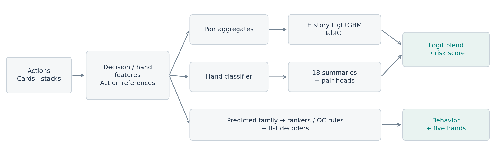
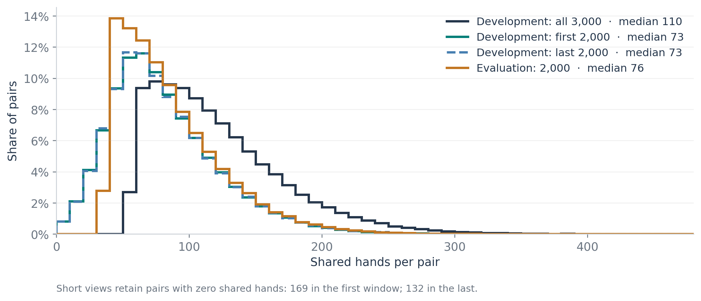

# 5th Place Solution: Pair Detection and Evidence Ranking

LightGBM, TabICL and pooled hand scores for pair detection, with separate models to select evidence from shared poker histories.

We combined LightGBM, TabICL and hand pooling for pair detection, with separate models for evidence selection. The final submission scored **0.93012 Public and 0.93416 Private**.

## From poker actions to model inputs

Decision features recorded cards, actions, call amounts and partner state. Hand features covered chip transfers, strong-hand folds, aggression and responses to partner bets.



For a fold, we kept the player's hand strength, how much they had already invested and whether their partner was still active. We also compared play against the partner with play against other opponents, to help separate general passivity from behavior specific to one opponent. We calculated features in both player directions and summarized counts, amounts, tails and timing across the pair's history. IDs were used for joins and grouping.

We trained LightGBM and neural models to predict actions. The probability they assigned to an observed action gave us a measure of how unusual it was in context. We used these probabilities and residuals as features. The neural model combined numerical and card inputs with a 96-unit GRU over the previous 16 actions, followed by two 384-unit layers. Training used four-class cross-entropy, AdamW and hand-based cross-fitting.

These models learned from unlabelled actions in both development and evaluation. One original input contained the final board length, including at earlier decisions. We fitted another version using the board length visible at that point. Both versions are in the final ensemble. The original therefore uses information the player did not have when acting.

## Pair detection

Development provides 372 positive pairs and 1,488 confirmed non-target pairs. The others are unknown. For pair training, we treated unknown pairs as negatives under a positive-unlabeled assumption. We evaluated confirmed negatives separately.

**Matching the history length.** Each table has 3,000 development hands and 2,000 evaluation hands. The median pair shares 110 hands in full development histories, versus 76 in evaluation. We trained the history classifiers on two views per development pair: the first and last 2,000 table hands. Both have a median of 73 shared hands. The windows overlap and should not be counted as independent histories.



**History models.** We averaged five LightGBM classifiers with 500 trees, 31 leaves, learning rate 0.03 and L2 regularization 5. We selected features by gain on labelled pairs and 45,000 sampled unknowns, then added ratios, giving 1,243 columns. Another five models used features from the corrected action reference.

**TabICL.** We used two final contexts, each containing all 1,860 labelled pairs and 8,000 sampled unknowns. Feature selection used family-wise marginal AUC and correlation pruning. We ran 96- and 192-feature versions, keeping the original 96 columns and both contexts when expanding the feature set. Both used `tabicl-classifier-v2-20260212.ckpt`, eight estimators and 1,024-row query batches.

**Hand pooling.** The third detector started with individual hands. We trained a classifier on listed evidence and hands of confirmed negatives, leaving out unlisted hands of positive pairs. For each pair, we summarized its hand scores with 18 distribution and timing features, then fitted two LightGBM pair classifiers. Training features came from out-of-fold hand scores. Evaluation used the final hand model and thresholds recorded during cross-fitting.

We combined the models as follows:

```
0.1875 × logit(history_original)
+ 0.1875 × logit(history_corrected)
+ 0.1875 × logit(TabICL_96)
+ 0.1875 × logit(TabICL_192)
+ 0.25   × mean(pool_head_logits)
```

For the history and TabICL models, we averaged probabilities before taking logits. We ranked all 112,540 evaluation pairs by the combined score and converted ranks to percentiles, averaging ties.

## Selecting evidence

A positive pair label does not tell us which hands belong on the evidence list. We trained hand rankers separately for directed transfer, soft play and coordinated isolation. Each family had LightGBM LambdaRank and XGBoost `rank:map` models, both with 750 rounds, using hand features and cross-fitted teacher predictions. A multiclass pair model chose the family at inference. We averaged the two rankers' within-pair ranks.

We gave these ranks half the weight in the final evidence blend. The other half used list order. Some supplied evidence lists jump backwards in time when read in evidence-rank order. We split them at that point to define two event groups. A cross-fitted classifier assigned groups to lists without a break. We trained two classifiers per family, each averaged over three seeds, and excluded some unlisted hands past inferred list boundaries.

After scaling outputs by 1.4, a capped Poisson-binomial decoder estimated whether each hand would fall among the first five events, placing one group first. This assumes a particular structure in how the lists were assembled. We ran detailed ranking on shared hands with actions by both players, within the historical baseline's fixed top 10,000 pairs.

For `other_coordination`, we had no positive labels. We combined fold residuals, partner-card dependence and action likelihoods to select 97 pairs. Their hand scores used preflop aggression and folds relative to partner strength. We compared action rates for selected and random pairs to derive bin weights, then rescaled them to a maximum of 0.45. A chronological decoder put aggression first and applied the five-event cap. Without OC evidence labels, we could not measure its MAP.

## Validation and results

For the final risk changes, we used 240 tables for base training, 80 for choosing changes and 80 for testing, then repeated with another partition. The action models had still seen unlabelled actions from those tables. We reported results on confirmed labels and separately on the full pair set, treating unknowns as negatives for the latter PU proxy.

The official score is `0.7 × PairAP + 0.2 × EvidenceMAP@5 + 0.1 × BehaviorMAP`. Risk affects both PairAP and BehaviorMAP. These submissions changed only risk:

| Risk model | Public | Private |
|---|---:|---:|
| Original reference + TabICL-96 | 0.92902 | 0.93249 |
| Original reference + TabICL-192 | 0.92898 | 0.93405 |
| Final blend | **0.93012** | **0.93416** |

Offline, the final blend's PU score changes ranged from −0.00699 to +0.00948 across two partitions and three history windows. All six table-bootstrap intervals included zero. The partitions reuse the same data, and we had already tested other variants before settling on this blend.

We also tried a decision encoder that postponed pooling and an OC evidence model based on how much partner cards helped predict actions. Neither reliably improved the stronger evidence system. Replacing 54 lists with the OC model's picks reduced Public from 0.92902 to 0.92374.

## Five evidence examples

We chose these examples after inspecting the submitted lists of 60 highly ranked pairs. Evaluation labels are unavailable. Amounts are in big blinds.

1. **Folding the nut straight.** A player with 2♥3♦ folds on A♦4♠5♣ when the partner bets 7.5 into 7.5 with K♣7♠. The player could also have failed to recognize the wheel.  
   `PD5956DB3CCF8 / HA4449DCF8340CB`
2. **Folding a queen-high flush.** Q♠7♠ folds on 5♠T♠2♠ to the partner's pot-sized bet of 6 with 9♠J♦. A player worried about a higher flush could make this fold without cooperating.  
   `P3BC799907F24 / HDBE051529A86F2`
3. **Folding the nut flush.** A♥5♥ folds on 7♥J♥6♥ to the partner's 5.5 bet into 10, with a third player still in the hand. A card-evaluation error could also cause this fold.  
   `P4F2E1B7504EA / H01C7A047B33F2B`
4. **Checking back the nuts.** With 9♥8♣ on 6♥7♠5♥2♠K♦, a player checks behind after every street checked through. The partner holds K♥Q♣. There is no value bet against top pair, but habitual passivity would also fit.  
   `P232551F28990 / H1B6C1C5DA94E3C`
5. **Reraising after two other players call.** A♣5♣ opens to 3; partner 8♣4♣ raises to 10.5; two others call. A♣5♣ raises to 23.5 and everyone folds. The pair's combined profit is 22. A light three-bet followed by an independent four-bet bluff could produce the same sequence.  
   `P36779CA5688F / HEC52DDB1E433B1`

## Reproduction

The [software package](README.md) includes code, saved weights, ordered feature lists and a locked uv environment. The retained weights reproduced the submitted CSV byte for byte in two raw-data GPU runs. The README gives the commands and the scope of the training checks. Neural and [TabICL](https://github.com/soda-inria/tabicl) runs used two T4 GPUs; tree models used CPU. Competition records and generated contexts are excluded from the code archive.
